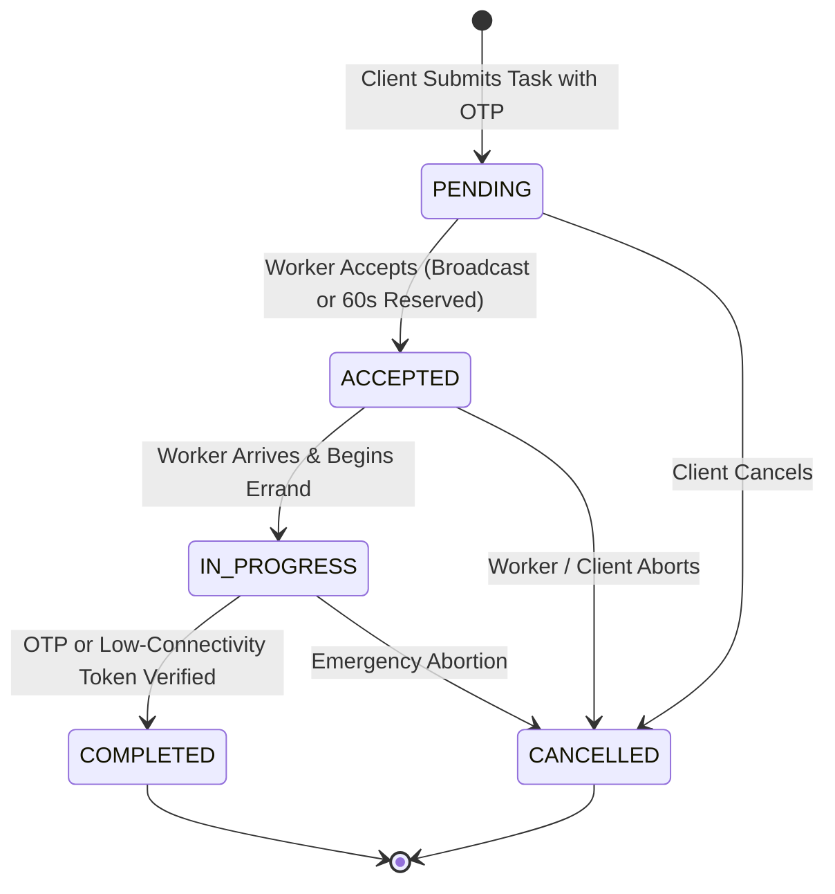

# 🏛️ ZOX SuperApp — Architectural Specification

This document provides a comprehensive technical overview of the **ZOX SuperApp (Mizoram Errand & Service Platform)** architecture, state machines, mathematical models for hill-terrain dispatch, database schema specifications, and offline security token generation.

---

## 1. System Topology

```
+------------------------------------------------------------------------+
|                            Client Tier                                 |
|   +-----------------------+   +-------------------+   +------------+   |
|   |  Responsive React 19  |   | Android Low-RAM   |   | Flutter    |   |
|   |  (PWA / Web Browser)  |   | Virtual Device    |   | Cross-App  |   |
|   +-----------+-----------+   +---------+---------+   +-----+------+   |
+---------------|-------------------------|-------------------|----------+
                |                         |                   |
                v                         v                   v
+------------------------------------------------------------------------+
|                          Application Server                            |
|  +------------------------------------------------------------------+  |
|  | Express 4.21 Gateway & Vite Dev / Static Middleware (server.ts)  |  |
|  |  * Role-Based Access Control (Client, Worker, Admin, Supervisor) |  |
|  |  * Permissive CORS for Web & Mobile Loopback (10.0.2.2:3000)     |  |
|  |  * Single Page Application fallback navigation handler           |  |
|  +----------------------------------+-------------------------------+  |
|                                     |                                  |
|          +--------------------------+-----------------------+          |
|          v                          v                       v          |
|  +---------------+          +---------------+       +---------------+  |
|  | Pricing Engine|          |  GPS Engine   |       | AI Supervisor |  |
|  |  (Elevation,  |          |  (Haversine & |       | (Gemini Flash |  |
|  |  Stair Steps, |          |   30 Aizawl   |       |  Mizo Voice / |  |
|  |  Platform Fee)|          |  Localities)  |       |  Text Parsing)|  |
|  +---------------+          +---------------+       +---------------+  |
+------------------------------------------------------------------------+
```

---

## 2. Hill-Terrain Mathematical Formulations

Standard flatland dispatch engines use Euclidean or standard Haversine distance, which fails dramatically in Mizoram where straight-line paths cross sheer ravines and cliffs.

### A. Switchback Hill Distance
The actual road travel distance $D_{\text{road}}$ is computed by augmenting straight-line Haversine distance $D_{\text{haversine}}$ with a terrain switchback factor:

$$D_{\text{road}} = D_{\text{haversine}} \times \left(1.25 + 0.04 \times \text{diff}\right)$$

Where $\text{diff} \in [1, 5]$ is the locality terrain difficulty score.

### B. Elevation Gradient & Delta
Given origin altitude $h_A$ and destination altitude $h_B$ (in meters above sea level):

$$\Delta h = h_B - h_A$$

$$\text{Grade \%} = \left(\frac{|\Delta h|}{D_{\text{haversine}} \times 1000}\right) \times 100$$

* If $\Delta h > 40\text{m}$, the trip is classified as **Uphill Climb** ($\times 1.25$ surge).
* If $\Delta h < -40\text{m}$, the trip is classified as **Downhill Descent** ($\times 1.10$ brake wear surge).
* Otherwise, it is classified as **Ridge Level**.

### C. Total Errand Fare Calculation
$$\text{Total Fee} = \text{Base Price} + \left(D_{\text{road}} \times \text{Rate}_{\text{km}}\right) + \text{Surcharge}_{\text{hill}} + \left(\text{Stair Steps} \times \text{Rate}_{\text{stair}}\right) + \text{Urgency Surge}$$

Where:
* $\text{Rate}_{\text{stair}} = ₹0.60$ per concrete stair step
* $\text{Urgency Surge} = ₹30$ if task is marked Express / Urgent

### D. Dynamic Platform Commission
$$\text{Worker Earnings} = \text{Total Fee} \times \left(1 - \frac{\text{Platform Fee \%}}{100}\right)$$

$$\text{Platform Commission} = \text{Total Fee} \times \left(\frac{\text{Platform Fee \%}}{100}\right)$$

*At launch, $\text{Platform Fee \%} = 0\%$, meaning $\text{Worker Earnings} = \text{Total Fee}$.*

---

## 3. Task Lifecycle State Machine

Tasks strictly adhere to a deterministic state machine:



Invalid transitions (such as transitioning from `PENDING` directly to `COMPLETED`) are strictly rejected by `isValidStatusTransition()`.

---

## 4. Cryptographic Low-Connectivity Offline Token

When workers deliver goods down remote cliff staircases without cellular data, the system relies on an offline verification token derived from SHA-256:

$$\text{Token} = \text{SHA-256}\left(\text{TaskID} \parallel \text{Phone} \parallel \text{Timestamp} \parallel \text{"MIZO\_ERRAND"}\right)[0 \dots 8]$$

Formatted as:
$$\text{MZ-}[H_0 H_1]\text{-}[H_2 H_3]$$

This token can be checked upon reconnection to prove that the worker and client physically interacted at the drop locality.

---

## 5. PostgreSQL Database Schema (Production Target)

```sql
CREATE TYPE task_status AS ENUM ('PENDING', 'ACCEPTED', 'IN_PROGRESS', 'COMPLETED', 'CANCELLED');
CREATE TYPE task_urgency AS ENUM ('standard', 'urgent', 'scheduled');
CREATE TYPE payment_mode AS ENUM ('cod', 'upi_direct', 'prepaid');

CREATE TABLE tasks (
  id VARCHAR(32) PRIMARY KEY,
  title VARCHAR(255) NOT NULL,
  title_mizo VARCHAR(255) NOT NULL,
  category VARCHAR(64) NOT NULL,
  client_phone VARCHAR(20) NOT NULL,
  client_name VARCHAR(100) NOT NULL,
  pickup_locality VARCHAR(64) NOT NULL,
  drop_locality VARCHAR(64) NOT NULL,
  base_fee NUMERIC(10, 2) NOT NULL,
  hill_surcharge NUMERIC(10, 2) DEFAULT 0,
  stair_fee NUMERIC(10, 2) DEFAULT 0,
  total_fee NUMERIC(10, 2) NOT NULL,
  worker_earnings NUMERIC(10, 2) NOT NULL,
  platform_fee_percent NUMERIC(5, 2) DEFAULT 0,
  estimated_item_budget NUMERIC(10, 2) DEFAULT 0,
  payment_mode payment_mode DEFAULT 'cod',
  urgency task_urgency DEFAULT 'standard',
  scheduled_time TIMESTAMPTZ,
  preferred_worker_id VARCHAR(64),
  handshake_expires_at TIMESTAMPTZ,
  worker_id VARCHAR(64),
  worker_name VARCHAR(100),
  completion_otp VARCHAR(6) NOT NULL,
  low_connectivity_token VARCHAR(20) NOT NULL,
  status task_status DEFAULT 'PENDING',
  created_at TIMESTAMPTZ DEFAULT NOW(),
  completed_at TIMESTAMPTZ
);

CREATE INDEX idx_tasks_status ON tasks(status);
CREATE INDEX idx_tasks_locality ON tasks(pickup_locality, drop_locality);
CREATE INDEX idx_tasks_worker ON tasks(worker_id);
```
