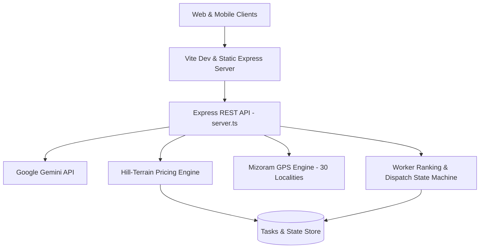

# 🏔️ ZOX SuperApp — Mizoram Errand & Service Platform

[](https://github.com/sakteapa/Mizoram-errand/actions)
[](https://www.typescriptlang.org/)
[](https://react.dev/)
[](https://tailwindcss.com/)
[](LICENSE)
[-success.svg)](src/utils/pricingEngine.test.ts)
[](src/types/platform.ts)

**ZOX SuperApp** is a production-grade, hyper-localized on-demand errand, dispatch, and multi-service platform engineered specifically for **Mizoram's steep hill terrain, high-altitude cliff localities, and concrete staircase pathways** across Aizawl, Lunglei, Champhai, and surrounding hill districts.

Built with high resilience for mountainous connectivity conditions, native **Mizo ṭawng bilingual support**, an eye-friendly **Midnight Dark Theme**, dynamic plugin service modules, and an **AI Logic Supervisor** powered by Google Gemini.

---

## 🌟 Key Features

### ⛰️ 1. Hill-Terrain & Staircase Pricing Engine
Unlike standard flatland delivery apps, ZOX calculates true energetic expenditure and transit difficulty across Aizawl ridges:
* **Switchback Road Distance**: Incorporates winding hill curvature factors ($1.25\times$ to $1.45\times$).
* **Elevation Delta ($\Delta h$)**: Differentiates between Uphill climb, Steep downhill descent, and Ridge-level transport.
* **Concrete Stair Steps Surcharge ($\Delta s$)**: Fair compensation for workers carrying heavy items up steep cliffside staircases (e.g. ₹0.60/step).
* **Slope Gradient Percentage**: Automatically flags dangerous switchbacks and cliff ascents.

### 💼 2. Dynamic Platform Commission (0% Launch Setup)
* **Default 0% Launch Model**: 100% of the errand fare goes straight into the field worker's pocket during the launch promotional phase.
* **Real-time Admin Slider**: Platform fee can be adjusted dynamically from **0% to 30%** with quick presets (`0% Launch`, `5% Starter`, `8% Balanced`, `10% Standard`, `15% Enterprise`).
* **Transparent Worker Payout**: Live calculation showing exact worker earnings and platform deduction on every task.

### 📦 3. Advanced Task Creation & Dispatch Flow (Option C)
* **Estimated Item Purchase Budget**: Clients specify goods budget with flexible payment modes (`COD / Cash on Delivery`, `UPI Direct to Worker`, `Prepaid`).
* **Urgency & Scheduling**:
  * ⚡ **Urgent / Express Dispatch**: Adds +₹30 rush surcharge and prioritizes matching.
  * 📅 **Scheduled Later**: Date & time picker for pre-planned hospital/market pickups.
* **Smart Auto-Dispatch vs. Preferred Worker**:
  * Broadcast to nearest verified workers in the locality.
  * Pick a preferred trusted worker with a **60-second reserved handshake window**.
* **Direct WhatsApp Handshake**: One-click WhatsApp button on both Client and Worker portals pre-filled with bilingual Mizo errand instructions and contact details.
* **Store Bill & Receipt Verification**: Workers can upload or attach bill photo proof before collecting item reimbursements.

### 🌙 4. Eye-Friendly Midnight Dark Theme
* **Zero-Glare Palette**: High-contrast, soothing slate obsidian theme (`#090e17` background, `#121929` surface cards, soft `#1e2c44` borders).
* **Header Theme Switcher**: Instant one-click toggle between 🌙 Dark Mode (Default) and ☀️ Light Mode with preference saved to `localStorage`.
* **Themed SVG GPS Terrain Map**: Low-light mountain contour visualization with real-time waypoint rendering.

### 📶 5. Low-Connectivity Offline Security Tokens
* **Mizoram Hill-Station Fallback**: Generates cryptographic 8-character verification tokens (`MZ-XXXX-XXXX`) allowing completed tasks to be verified even during sudden cellular blackouts or monsoon weather drops.

### 🤖 6. AI Logic Supervisor (Google Gemini)
* Natural language prompt analysis in **Mizo ṭawng** and English (e.g., *"Durtlang Synod atangin damdawi Zarkawt-ah min laksak rawh"*).
* Automatically extracts category, pickup locality, destination locality, estimated stairs, and difficulty ratings.

---

## 🛠️ Architecture & Tech Stack



| Layer | Technologies |
|---|---|
| **Frontend UI** | React 19, TypeScript 5.8, Tailwind CSS v4, Lucide Icons, Motion |
| **Server & API** | Node.js, Express 4.21, `tsx`, Vite Middleware Mode, RESTful Endpoints |
| **AI Integration** | Google Gemini API (`@google/genai`) for multi-turn task parsing |
| **Geolocation** | Haversine distance, hill terrain multipliers, Aizawl landmark coordinates |
| **Testing** | Node.js Native Test Runner (`node --test`), 17 comprehensive unit tests |
| **Target Platforms** | Responsive Web (Desktop & Mobile), Android Emulator (Low-RAM setup), Flutter cross-platform architecture specifications |

---

## 🚀 Quick Start & Installation

### Prerequisites
* **Node.js**: v18.0.0 or higher (v20+ recommended)
* **npm**: v9.0.0 or higher

### 1. Clone the Repository
```bash
git clone https://github.com/sakteapa/Mizoram-errand.git
cd Mizoram-errand
```

### 2. Install Dependencies
```bash
npm install
```

### 3. Configure Environment Variables
Copy `.env.example` to `.env`:
```bash
cp .env.example .env
```
Fill in your optional Google Gemini API key:
```env
GEMINI_API_KEY="your-google-gemini-api-key"
PORT=3000
```

### 4. Run the Development Server
```bash
npm run dev
```
Open **[http://localhost:3000](http://localhost:3000)** in your browser.

---

## 🧪 Testing & Code Quality

Run the unit test suite:
```bash
npm test
```

Run TypeScript static type-checking:
```bash
npm run lint
```

Build production bundle:
```bash
npm run build
```

### Test Suite Highlights
All **17/17 tests pass (100%)**:
* ✔ `calculateDistrictMetrics`: totals, completion rates, empty arrays
* ✔ `calculateGrowthRate`: positive & negative percentage shifts
* ✔ `formatIndianCurrency`: Lakhs & Crores formatting
* ✔ `calculateHaversineDistance` & `calculateHillRoadDistance`: switchback multiplier
* ✔ `calculateElevationDelta` & `calculateSlopeGradient`: ridge detection
* ✔ `findNearestLocality` & `computePointToPointRoute`: Aizawl GPS routing
* ✔ `validateAndFormatMizoPhone`: Indian & Mizoram phone validation
* ✔ `calculateHillTerrainFare`: hill steepness & concrete stair fees
* ✔ `isValidStatusTransition`: strict task lifecycle enforcement
* ✔ `generateLowConnectivityToken`: cryptographic offline verification
* ✔ `rankWorkerCandidates`: locality-based worker scoring

---

## 📱 Android Emulator (Low-RAM Setup)

To test the application on Android using minimal system resources:
1. Ensure the Android SDK is installed.
2. The project includes automated support for the `small_phone` AVD profile:
   * **RAM Allocation**: 2048 MB (with 256 MB heap size).
   * **Resolution**: 720 × 1280.
3. Access the local backend server from within the Android emulator at:
   ```
   http://10.0.2.2:3000
   ```

---

## 🗺️ Covered Mizoram Localities (Aizawl & Districts)

ZOX incorporates built-in GPS coordinates, altitudes, and terrain steepness indexes for:
* **Aizawl Core**: Bara Bazar, Zarkawt, Chanmari, Khatla Secretariat, Kulikawn, Durtlang Leitan, Bawngkawn, Mission Veng, Ramhlun North, Laipuitlang Ridge.
* **Extended Towns**: Lunglei Venglai, Champhai Kahrawt, Serchhip, Kolasib, Saitual, Mamit, Hnahthial, Lawngtlai, Siaha.

---

## 🤝 Contributing

Contributions are warmly welcomed! Please read our [CONTRIBUTING.md](CONTRIBUTING.md) guide and adhere to our [Code of Conduct](CODE_OF_CONDUCT.md).

1. Fork the Project
2. Create your Feature Branch (`git checkout -b feature/AmazingFeature`)
3. Commit your Changes (`git commit -m 'feat: Add AmazingFeature'`)
4. Push to the Branch (`git push origin feature/AmazingFeature`)
5. Open a Pull Request

---

## 📄 License

Distributed under the MIT License. See [LICENSE](LICENSE) for more information.

---

## 📬 Contact & Support

* **Project Lead**: Samuel ([@sakteapa](https://github.com/sakteapa))
* **Repository**: [https://github.com/sakteapa/Mizoram-errand](https://github.com/sakteapa/Mizoram-errand)
* **Region**: Aizawl, Mizoram, India 🇮🇳
